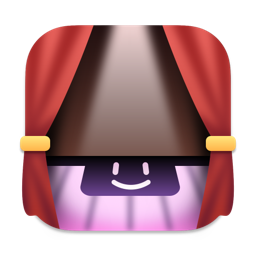

# GravityNotch (BoringNotch Pro Edition)

> **Notice de licence & crédits (GPL-3.0)** : Ce projet est un fork enrichi basé sur [TheBoredTeam/boring.notch](https://github.com/TheBoredTeam/boring.notch), distribué sous licence libre **GNU General Public License v3.0 ([`LICENSE`](LICENSE))**. Tous les droits et crédits de l'architecture d'origine reviennent aux auteurs de *Boring Notch*.

**GravityNotch** transforme l'encoche (Notch) de votre MacBook en un véritable centre de contrôle dynamique de style *Dynamic Island*, combinant la stabilité et le design natif de **Boring Notch** avec une suite complète d'outils de productivité, de capture OCR, de contrôle média avancé et de suivi d'agents IA.

<p align="center"></p>

🌐 **Site du projet** : [adrielakak.github.io/GravityNotch](https://adrielakak.github.io/GravityNotch/) (démos vidéo, installation et FAQ)

---

## ⬇️ Télécharger pour Mac

**[Télécharger GravityNotch.dmg](https://github.com/adrielakak/GravityNotch/releases/latest/download/GravityNotch.dmg)** (macOS 14 Sonoma ou plus récent, Apple Silicon et Intel)

1. Ouvrez `GravityNotch.dmg` et glissez **GravityNotch** dans le dossier **Applications**.
2. Lancez l'app. macOS affiche un avertissement au premier lancement, car l'app n'est pas signée avec un certificat développeur Apple payant : cliquez sur **Terminé**.
3. Ouvrez **Réglages Système > Confidentialité et sécurité**, descendez jusqu'à la section **Sécurité** et cliquez sur **Ouvrir quand même**, puis confirmez.
4. Accordez la permission **Accessibilité** quand l'app la demande (nécessaire pour remplacer les HUD de volume et de luminosité).

Si le bouton **Ouvrir quand même** n'apparaît pas, lancez cette commande dans le Terminal puis rouvrez l'app :

```bash
xattr -cr /Applications/GravityNotch.app
```

Toutes les versions sont listées sur la page [Releases](https://github.com/adrielakak/GravityNotch/releases).

---

## ✨ Nouvelles fonctionnalités ajoutées dans cette édition

### 1. 🔒 Lecteur média sur l'écran verrouillé + paroles karaoké (`SkyLightWindow`)
- **Panneau en verre dépoli sur l'écran verrouillé macOS**, affiché par-dessus l'écran de verrouillage grâce au framework privé `SkyLight`.
- **Contrôles complets** : barre de progression interactive (scrub), précédent (redémarre le titre comme Apple Music), lecture/pause, suivant, et sélecteur de sortie audio `CoreAudio`.
- **Paroles synchronisées en direct** : ligne précédente estompée, ligne chantée en blanc lumineux et ligne suivante, via LRCLIB (avec nettoyage automatique des suffixes `(Slowed)` / `(Remix)`) ou les paroles intégrées d'Apple Music. Un tap sur une ligne saute à ce moment du morceau.
- **Fond d'écran animé** : quand le titre possède une pochette animée Apple Music, elle s'affiche automatiquement en plein écran à chaque verrouillage (mise en cache locale, partagée sur tout l'album pour éviter les clignotements entre les titres). Une pochette fixe s'agrandit simplement dans le lecteur au tap.
- Halo d'ambiance optionnel et réglages dédiés (lecteur, halo, paroles) dans les préférences.

### 2. 🎵 Playing Next (File d'attente Apple Music interactive)
- Bouton **`music.note.list`** intégré directement aux contrôles du lecteur musical.
- Bascule fluide dans l'onglet **Home** entre le **Calendrier Apple** et la liste **Playing Next**.
- Clic direct sur n'importe quel titre à venir pour le jouer immédiatement, ou bouton **`arrow.up.to.line`** pour le remonter en tête de file.
- Fonctionne aussi quand Music lit depuis le catalogue Apple Music (lecture de la page de l'album) et signale quand la lecture aléatoire masque l'ordre réel.

### 3. 🔆 System HUDs macOS Tahoe (Interception matérielle Triple-Couche `< 1 µs`)
- Remplacement complet des bulles système macOS (Volume, Luminosité écran, Rétroéclairage clavier et **Caps Lock HUD**) par une animation fluide directement dans l'encoche (*Dynamic Island*).
- Compatible **macOS 26 Tahoe** : interception simultanée sur `.cghidEventTap`, `.cgSessionEventTap` et `.cgAnnotatedSessionEventTap` sur une file `.userInteractive` dédiée avec lecture directe des champs `CGEvent` (`99` et `149`) sans latence ni double HUD.

### 4. 🔍 Text Capture (Screen OCR) & Element Capture
- Bouton **`text.viewfinder`** dans l'en-tête de l'encoche :
  - **Clic gauche** : sélectionne une zone de l'écran et extrait instantanément le texte via Apple Vision (`VNRecognizeTextRequest`) directement dans le presse-papiers.
  - **Clic droit** : capture une zone ou une fenêtre/élément détouré directement vers le **Shelf**.

### 5. 📋 Onglet `Clips` (Gestionnaire d'historique du Presse-papiers)
- Surveillance en temps réel de `NSPasteboard.general` (texte, liens, fichiers, codes couleurs hexadécimaux avec aperçu couleur).
- Recherche instantanée, épinglage (*Pin*), copie en un clic et envoi direct d'un élément vers le **Shelf**.

### 6. ✨ Onglet `Agents` (Claude Code, Codex CLI & Antigravity en direct)
- Suivi en temps réel des sessions d'agents de code IA, lues localement depuis leurs transcripts (`~/.claude/projects`, `~/.codex/sessions`, Antigravity) :
  - Jauge de **Context / Quota** (`input_tokens + cache_read_tokens`), taux de **Cache Hit %**, tokens générés (`output_tokens`) et numéro d'étape (`Step #`).
  - Checklist de **progression**, pastille des fichiers modifiés avec compteurs de diff, et flux d'outils en direct (*Live Tool Feed*).
  - **Mascottes pixel** animées selon l'état de l'agent (au travail, en attente, endormi).
- Une session reste considérée active pendant une longue commande ou réflexion silencieuse (jusqu'à 10 min en cours de tour) ; l'encoche revient automatiquement sur la session en direct 2 min après une sélection manuelle.
- **Live Activity** sur l'encoche fermée, avec une bulle sous l'encoche quand un agent termine ou a besoin de vous.

### 7. ☕ Mode Caffeine, 🎧 Sortie Audio & ⚡ Actions Rapides Shelf
- **Caffeine (`IOKit` Power Assertion)** : empêche la mise en veille du Mac (infini, 15 min, 30 min, 1 h, 2 h) depuis l'en-tête de l'encoche.
- **Sélecteur de sortie audio (`CoreAudio`)** : bascule instantanément entre les haut-parleurs du MacBook, AirPods ou écrans externes.
- **Actions rapides Shelf** : extraction **OCR** sur les images déposées, compression **ZIP**, conversion **PNG**, suppression d'arrière-plan (**BG** via `VNGenerateForegroundInstanceMaskRequest`) et partage instantané via lien **`0x0.st`**.

---

## 🛠️ Compilation & Installation depuis les sources

### Prérequis
- macOS 14 Sonoma, macOS 15 Sequoia ou **macOS 26 Tahoe**
- Xcode 16+

### Compiler

```bash
xcodebuild -project boringNotch.xcodeproj -scheme boringNotch -configuration Debug \
  CODE_SIGN_IDENTITY="-" CODE_SIGNING_REQUIRED=NO DEVELOPMENT_TEAM="" build
```

Si `xcodebuild` signale que le répertoire développeur actif est celui des Command Line Tools, préfixez la commande par `DEVELOPER_DIR=/Applications/Xcode.app/Contents/Developer`.

### Installer dans `/Applications`

Quittez l'app si elle tourne, puis copiez le produit de build depuis DerivedData (`Build/Products/Debug/boringNotch.app`) vers `/Applications` et lancez-le. La permission **Accessibilité** est requise pour les HUD système.

---

## 🌐 Site web

La landing page du projet se trouve dans [`docs/`](docs/) (HTML/CSS/JS statique, servie par GitHub Pages) : [adrielakak.github.io/GravityNotch](https://adrielakak.github.io/GravityNotch/).

---

## 📄 Licence & Remerciements

- Distribué sous licence **GNU General Public License v3.0**, voir le fichier [`LICENSE`](LICENSE).
- Basé sur le projet open-source [TheBoredTeam/boring.notch](https://github.com/TheBoredTeam/boring.notch).
