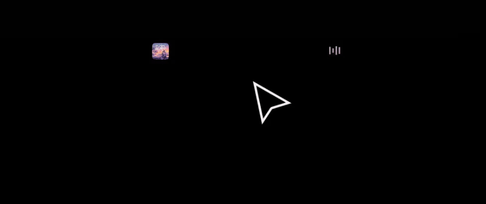

<p align="center"></p>

<h1 align="center">GravityNotch</h1>

<p align="center">
  <b>Turn your MacBook notch into a Dynamic Island.</b><br>
  Free and open source. System HUDs that work on macOS 26 Tahoe and macOS 27 Golden Gate, a lock screen music player with synced lyrics,<br>
  and live Claude Code / Codex agent tracking, right in the notch.
</p>

<p align="center">
  <a href="https://github.com/adrielakak/GravityNotch/releases/latest"></a>
  
  
  <a href="LICENSE"></a>
</p>

<p align="center">
  <a href="https://github.com/adrielakak/GravityNotch/releases/latest/download/GravityNotch.dmg"><b>⬇️ Download the DMG</b></a>
  &nbsp;·&nbsp;
  <a href="https://adrielakak.github.io/GravityNotch/"><b>🌐 Website & demos</b></a>
  &nbsp;·&nbsp;
  <a href="https://github.com/adrielakak/GravityNotch/issues?q=is%3Aissue+is%3Aopen+label%3A%22good+first+issue%22"><b>🤝 Good first issues</b></a>
</p>

<p align="center">
  
</p>

> **Credits (GPL-3.0)**: GravityNotch is an enhanced fork of [TheBoredTeam/boring.notch](https://github.com/TheBoredTeam/boring.notch), distributed under the [GNU General Public License v3.0](LICENSE). All credit for the original architecture and codebase goes to the *Boring Notch* authors.

---

## ⬇️ Download for macOS

**[Download GravityNotch.dmg](https://github.com/adrielakak/GravityNotch/releases/latest/download/GravityNotch.dmg)** (macOS 14 Sonoma or later · Apple Silicon and Intel)

Or install with [Homebrew](https://brew.sh), launch the app once, then follow steps 2 and 3 below:

```bash
brew install --cask adrielakak/tap/gravitynotch
```

1. Open `GravityNotch.dmg`, drag **GravityNotch** into the **Applications** folder, launch it once, and dismiss the macOS warning (**Done**).
2. Open **System Settings > Privacy & Security**, scroll **all the way down** to the **Security** section, click **Open Anyway**, and confirm.
3. Follow the startup guide to grant **Accessibility** permission (required to display volume and brightness HUDs in the notch). On macOS 27 this permission is called **Device Control and Data Access**.

If **Open Anyway** does not appear, run this command in Terminal and reopen the app:

```bash
xattr -cr /Applications/GravityNotch.app
```

Curious about a feature, a permission or what goes over the network? Everything is explained in the [documentation](https://adrielakak.github.io/GravityNotch/docs.html).

All releases are available on the [Releases](https://github.com/adrielakak/GravityNotch/releases) page. Starting with **v1.2.6**, built-in Sparkle updates check and install new versions automatically from GitHub.

---

## ✨ What's New in GravityNotch

### 1. 🔒 Lock Screen Media Player & Synced Lyrics (`SkyLightWindow`)
- **Frosted glass lock screen panel**, rendered above the macOS lock screen via `SkyLight`.
- **Full playback controls**: interactive scrub bar, previous/restart track, play/pause, next track, and `CoreAudio` output switcher.
- **Live synced lyrics**: dimmed previous line, glowing active line, and next line via LRCLIB (with automatic cleanup of `(Slowed)` / `(Remix)` suffixes) or embedded Apple Music lyrics. Click any line to jump to that timestamp.
- **Full screen lyrics layout** (new in 1.3): the player on the left and the lyrics on the right, like Apple Music. The active line lights up word by word, the other lines blur with their distance, the list scrolls like a wave, and animated dots fill the instrumental breaks. Without lyrics the player moves to the center; a button hides or shows the lyrics. Each layout keeps its own position settings.
- **Choice of lyrics source** (new in 1.3): LRCLIB, free and open source, for everyone (the default), or **Apple Music**, which gives the exact lyrics and timing of the Music app, syllable by syllable. Apple Music needs a subscription and a one-time sign in, falls back to LRCLIB for songs outside its catalog, and relies on the Apple Music web player, so it may stop working if Apple changes it.
- **Animated artwork wallpaper (Apple Music only)**: when a track has Apple Music motion artwork, it fills the lock screen automatically on lock (cached locally per album to avoid flicker across tracks). Static artwork enlarges cleanly inside the player on tap.
- **Smart idle hiding**: automatically stays hidden when no music is loaded or the player app has quit, while remaining visible whenever a track is paused.
- Optional ambient glow and per-feature toggles in Preferences.

### 2. 🎵 Playing Next (Interactive Queue)
- **`music.note.list`** button built directly into the music player controls.
- Seamless toggle in the **Home** tab between your **Calendar** and the **Playing Next** queue.
- Click any upcoming track to play it immediately, or use **`arrow.up.to.line`** to promote it to the top of the queue.
- Also works when streaming from the Apple Music catalog (reads the album tracklist) and warns when Shuffle hides the actual order.

### 3. 🔆 System HUDs for macOS Tahoe & Golden Gate
- Replaces the macOS system HUDs (Volume, Display Brightness, Keyboard Backlight, and **Caps Lock HUD**) with smooth animations inside the notch.
- Compatible with **macOS 26 Tahoe** and **macOS 27 Golden Gate**: intercepts hardware media keys via `.cghidEventTap`, `.cgSessionEventTap`, and `.cgAnnotatedSessionEventTap` on a `.userInteractive` queue, reading `CGEvent` fields (`99` and `149`) with zero latency or duplicate system popups.

### 4. 🔍 Text Capture (Screen OCR) & Element Capture
- **`text.viewfinder`** button in the notch header:
  - **Left-click**: select any region of the screen and extract text straight to your clipboard via Apple Vision (`VNRecognizeTextRequest`).
  - **Right-click**: capture a region or window/element directly into the **Shelf**.

### 5. 📋 `Clips` Tab (Clipboard History Manager)
- Live monitoring of `NSPasteboard.general` (text, links, files, and hex color codes with live color swatches).
- Instant search, pinning, one-click copy, and send-to-Shelf actions.

### 6. ✨ `Agents` Tab (Claude Code, Codex CLI & Antigravity Live Tracking)
- Real-time local monitoring of AI coding agent sessions from their transcripts (`~/.claude/projects`, `~/.codex/sessions`, Antigravity):
  - **Context / Quota** gauge (`input_tokens + cache_read_tokens`), **Cache Hit %**, generated tokens (`output_tokens`), and step counter (`Step #`).
  - **Progress checklist**, edited file pills with diff counts, and **Live Tool Feed**.
  - **Animated pixel mascots** reflecting each agent's live state (working, waiting, idle).
- Keeps sessions active during long-running commands or silent thinking (up to 10 min mid-turn) and returns to the live session automatically 2 min after manual selection.
- **Live Activity** on the closed notch plus a status popover when an agent finishes or needs input.

### 7. ☕ Caffeine, 🎧 Audio Output & ⚡ Shelf Quick Actions
- **Caffeine (`IOKit` Power Assertion)**: keep your Mac awake (indefinitely, 15 min, 30 min, 1 h, or 2 h) directly from the notch header.
- **Audio Output Switcher (`CoreAudio`)**: switch between MacBook speakers, AirPods, or external displays in one click.
- **Shelf Quick Actions**: **OCR** on dropped images, **ZIP** compression, **PNG** conversion, background removal (**BG** via `VNGenerateForegroundInstanceMaskRequest`), and instant file sharing via **`0x0.st`**.

---

## 🛠️ Building from Source

### Requirements
- macOS 14 Sonoma, macOS 15 Sequoia, macOS 26 Tahoe, or **macOS 27 Golden Gate**
- Xcode 16+

### Build

```bash
xcodebuild -project boringNotch.xcodeproj -scheme boringNotch -configuration Debug \
  CODE_SIGN_IDENTITY="-" CODE_SIGNING_REQUIRED=NO DEVELOPMENT_TEAM="" build
```

If `xcodebuild` reports that Command Line Tools are selected instead of Xcode, prefix the command with `DEVELOPER_DIR=/Applications/Xcode.app/Contents/Developer`.

### Package a Release DMG & Update Appcast

```bash
./Configuration/dmg/build_release_dmg.sh
```

This builds the Release target, packages `build/GravityNotch.dmg`, signs it with Sparkle EdDSA, and updates [`docs/appcast.xml`](docs/appcast.xml).

---

## 🌐 Website

The project landing page lives in [`docs/`](docs/) (static HTML/CSS/JS served via GitHub Pages): [adrielakak.github.io/GravityNotch](https://adrielakak.github.io/GravityNotch/).

---

## 🤝 Contributing & Roadmap

- See [`ROADMAP.md`](ROADMAP.md) for upcoming Live Activities, planned bugfix batches, and feature ideas.
- Contributions are welcome, from first-timers too. Start with an issue labeled [`good first issue`](https://github.com/adrielakak/GravityNotch/issues?q=is%3Aissue+is%3Aopen+label%3A%22good+first+issue%22), and read [`CONTRIBUTING.md`](CONTRIBUTING.md) before opening a pull request (it explains one Xcode project quirk that will save you time).

---

## 📄 License & Acknowledgments

- Distributed under the **GNU General Public License v3.0**, see [`LICENSE`](LICENSE).
- Forked from [TheBoredTeam/boring.notch](https://github.com/TheBoredTeam/boring.notch).
